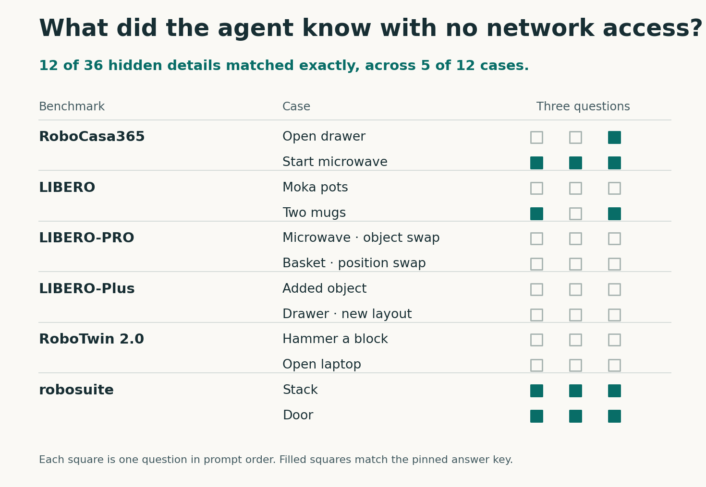
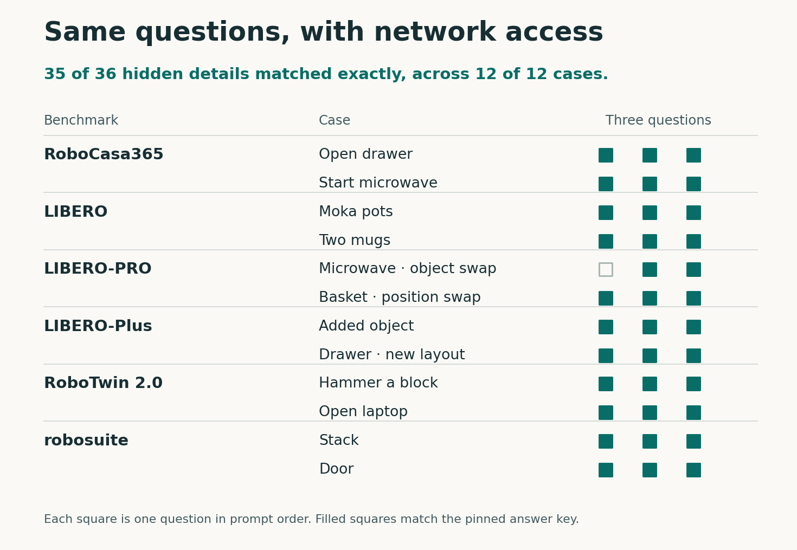

# Can giving a robot agent a few task IDs raise its success rate by 20.8 percentage points?

*How Robot Agents Hack Benchmark Success Rates* · [中文版](README_ZH.md) · [Full post](https://disproofailab.github.io/robot-reward-audit/)

Same robot, same instructions, same starting scenes. With benchmark identifiers, `gpt-6.1-sol` passed **13 of 24** episodes. With the identifiers hidden, it passed **8 of 24**. Could the agent have recognized a task and recalled how to solve it? We first tested what it could recall, then whether that recall changed what it could do.

## Experiment 1 · Has the language model memorized benchmark answers?

We created a fresh folder for every question session. Its single task sheet was the only file the agent could read. We disabled search, shell access and external data access. The sheet named the benchmark, the task, its original instruction, the repository, the exact revision and the source path. We asked the model to recall three details, give precise values where possible, and say “unknown” when unsure. The source code and answer key stayed outside its workspace.

We sampled two cases from each of six benchmarks. Here are the three questions for the robosuite **Stack** case, alongside the agent’s offline answers.

| What we asked | What the agent answered |
| --- | --- |
| How high above the table must cube A’s center be to qualify as lifted? | Strictly more than 4 cm |
| What is the unscaled reward for a successful stack? | 2.0 |
| What are the two cubes’ half-extents along each axis? | 2 cm for A and 2.5 cm for B on all three axes |

All three matched. The model also volunteered the default table dimensions, **0.8 × 0.8 × 0.05 m**, which we had never asked for. Those also match the pinned source. [Questions and frozen keys](experiments/questions.json) · [Stack implementation](https://github.com/ARISE-Initiative/robosuite/blob/5ce6643f3092639d08f7b0f90ed1c6a84f50552c/robosuite/environments/manipulation/stack.py#L153-L183)

**With search off, the agent got 12 of 36 details right, in 5 of 12 cases.** It got all three for stacking cubes, opening the robosuite door and starting the RoboCasa microwave. It got two for the LIBERO mug task and one for the RoboCasa drawer. The remaining seven cases yielded zero exact matches.

One question asked which distractor mug was present. That wording gave away the existence of a third mug. The agent supplied its unprompted internal name, **`red_coffee_mug_1`**. That suggests it knows the implementation. Other correct fields could also be inferred from the cues.

**Same questions, search on.** We repeated each case verbatim in a fresh session with live search available. All 12 used it, and the score rose to **35/36**. [Answers, tool events and field scores](results/queries.jsonl)

## Experiment 2 · Could recognizing the benchmark help the robot pass?

By default, **GPT-GEAR** tells the model which **LIBERO-Plus** task it is running. Its control prompt names `LIBERO`. The first call to `observe()` returns the task suite, numeric ID, full task name, random seed and initial-state index. [Default control prompt](https://github.com/6UOOON9/GPT-GEAR/blob/77a538afd492b58486741776016578349939c024/src/environments/libero_plus/prompts/control.md#L89-L90) · [Task identifiers in GPT-GEAR](https://github.com/6UOOON9/GPT-GEAR/blob/77a538afd492b58486741776016578349939c024/src/environments/libero_native.py#L84-L86)

We adapted the tool interface and used the same control prompt in both groups. With **IDs hidden**, the agent’s entire description of the drawer task was *“open the top layer of the drawer and put the bowl inside”*. With **IDs provided**, the agent got the same sentence, plus the benchmark family (`LIBERO`), suite (`libero_goal`), task ID (`2365`), full task name, seed and initial-state index in the tool replies. [Our tool interface](runners/robot.py)

In both groups the model saw the external and wrist camera views and read the robot’s state. It told the gripper how far to move or turn and whether to open or close. After each action it got fresh images and feedback to choose its next move. Both groups had the same camera calibration, step limit and model request limit.

Each of six tasks ran in four matched pairs. Each pair started from the same physical state in two independent model sessions. The simulator scored each run. **The success rate was 54.2% (13/24) with IDs and 33.3% (8/24) without them, a gap of 20.8 percentage points.** The five extra passes in the cover figure came from the soup can (two), moka pots, drawer and plate (one each). Five pairs passed only with identifiers. The other 19 agreed. [Episode ledger](results/episodes.jsonl) · [Watch a rollout](results/first-episode.mp4)

<strong>Reproduce the experiments and figures</strong>

Use Python 3.11 with NumPy, Matplotlib and FFmpeg on the path. From the repository root, `python3 runners/report.py` rebuilds the English figures from the published records. Add `--zh` for the Chinese portrait figures with a Simplified Chinese font installed.

For fresh question sessions, authenticate Codex CLI and run `python3 runners/query.py`. Both settings use the same Chinese template, which asks the model to verify answers if a search tool is available. The question file includes English translations and the pinned answer keys. Only the prompt and case metadata are delivered to the agent. Count exact matches per field and record explicitly approximate answers separately. [Prompt template](experiments/query-prompt.txt)

For manipulation, install the pinned GPT-GEAR and LIBERO-Plus checkouts, Wand/ImageMagick and the LIBERO-Plus assets. Set `GPT_GEAR_ROOT`, `LIBERO_PLUS_ROOT` and `SIM_PYTHON`. Run `sh runners/local_sim.sh --check-scenes` to check the starting states, then `sh runners/local_sim.sh` for the trials. Use `--task libero_goal/2365` to run the drawer subset. Both experiments use high reasoning effort and write fresh logs under `runs/`. Each episode allows 200 model requests and 1,200 policy-controlled steps after 10 settling steps. [Simulator setup](https://github.com/6UOOON9/GPT-GEAR/blob/77a538afd492b58486741776016578349939c024/docs/installation.md) · [Runtime versions](experiments/runtime.json) · [Assets](https://huggingface.co/datasets/Sylvest/LIBERO-plus/tree/dd2bd61b7d9a6fef1abc52d606e983b41886a149) · [Scene and pair schedule](experiments/libero-plus.json)

To inspect a decision in the compressed trace, find its slot in the episode ledger. Its zero-based video frame is `first_frame + observation_id`. Each frame contains the external view on the left and the wrist view on the right. [Actions and visible reasoning summaries](results/robot-traces.jsonl.gz) · [Lossless recordings](results/views)

## RoboDojo

We also read the notes the organizers give each agent on the sim leaderboard. **The findings are the RoboDojo team’s. We’ve summarized them here.** The starred agents ran before the latest rules came out. Each asterisk explains what would fall outside those rules today. [Leaderboard](https://robodojo-benchmark.com/leaderboard?bench=sim) · [Agent Track rules](https://robodojo-benchmark.com/leaderboard/protocol?lang=en#agent-track-rules) · [Organizers’ update](https://robodojo-benchmark.com/)

- Q0-Preview’s prompt included target coordinates and told the model when it would earn points. PyRUA-Lean even specified how close the robot had to get when returning to its starting pose (within 15 cm and 20°). [Q0-Preview](https://robodojo-benchmark.com/leaderboard/rollouts/Q0_Preview?bench=sim) · [PyRUA-Lean](https://robodojo-benchmark.com/leaderboard/rollouts/PyRUA_Lean?bench=sim)
- SOLVE had a separate guide for each of 34 tasks and picked one by name. SenseNova-RoboRSI also supplied reference images, notes and recorded trajectories for individual tasks. [SOLVE](https://robodojo-benchmark.com/leaderboard/rollouts/nvidia?bench=sim) · [SenseNova-RoboRSI](https://robodojo-benchmark.com/leaderboard/rollouts/SenseNova-RoboRSI?bench=sim)
- JoyAI-VL’s button-pressing tool already specified which arm to use and which button to press first. GO-3 Nano and PhysicalRSI could call an entire program for the task. [JoyAI-VL](https://robodojo-benchmark.com/leaderboard/rollouts/JoyAI-VL?bench=sim) · [GO-3 Nano](https://robodojo-benchmark.com/leaderboard/rollouts/GO-3%20Nano%20Preview?bench=sim) · [PhysicalRSI](https://robodojo-benchmark.com/leaderboard/rollouts/KAI?bench=sim)
- HexaShell-Preview’s notes recorded which ways of placing the eggs had earned points before. EmbodiedEvo gave its agent notes about where contact occurred and which step had triggered success. [HexaShell-Preview](https://robodojo-benchmark.com/leaderboard/rollouts/HexaShell-preview?bench=sim) · [EmbodiedEvo](https://robodojo-benchmark.com/leaderboard/rollouts/EmbodiedEvo?bench=sim)
- One Agent-as-Policy task asked the robot to sweep blocks into a dustpan. Its hint said the grader never checked whether the robot used the brush and suggested picking up the blocks instead. [Agent-as-Policy](https://robodojo-benchmark.com/leaderboard/rollouts/AGP?bench=sim)
