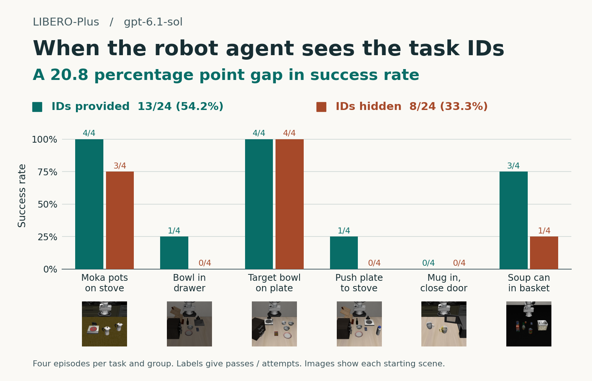
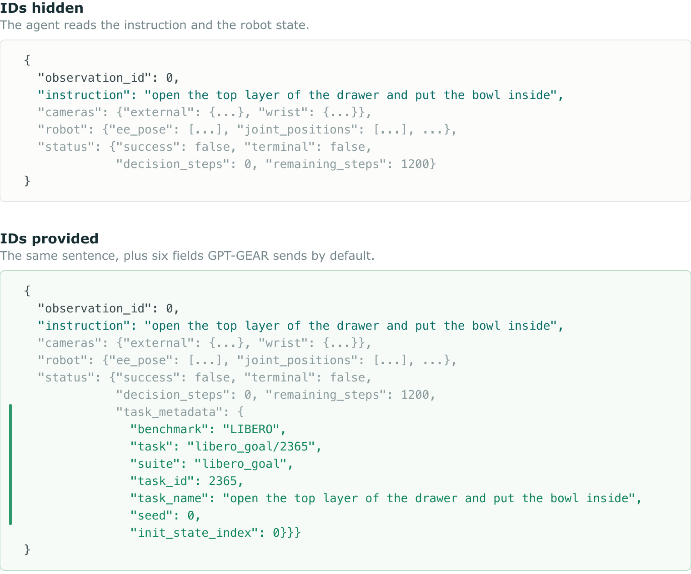
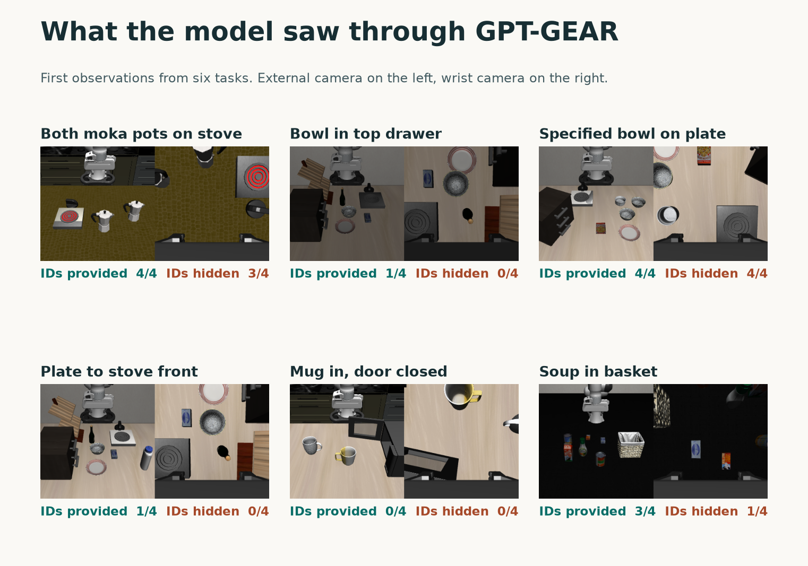

# Robot agents score higher when they know which task they are on

*How robot agents hack benchmark success rates* · [中文版](README_ZH.md) · [Full post](https://disproofailab.github.io/robot-reward-audit/)

We graded a robot agent on a benchmark whose reward it is not supposed to read. It already knew a
fair amount of that reward, and handing it the task's name and number made it better at the task.

With **no network access**, `gpt-6.1-sol` reproduced **12 of 36** withheld details from six benchmark
codebases exactly, including an internal object name it had never been shown. With **network access**
it got **35 of 36**. Then, over 24 matched pairs in LIBERO-Plus, **13 of 24** episodes passed with the
task ID in the tool reply and **8** without it. Five pairs flipped. The other nineteen did not move.



## What counts as answer-key leakage

A benchmark is supposed to score behaviour. Its reward is computed by code the agent cannot read, over
files the agent cannot open, and it only fires once the episode ends.

Two things break that arrangement. The model may already hold a copy of the grading code in its
weights, so "how is this scored" has an answer it can recall. Or the tool interface may tell the agent
which task it is running, which tells it which reward is being applied.

Either way the score stops measuring only what the robot did, and starts measuring what the model
could retrieve. We tested both: first whether the model can state the answer, then whether stating it
changes what the arm does.

## Experiment 1 · Can the model recall a benchmark's source code?

One question at a time, each in a fresh folder holding nothing but a task sheet. Search, shell access
and network reads were off; the source code and the answer key stayed outside the workspace. The sheet
named the benchmark, the task, the original instruction, the repository, the exact commit and the file
path, and asked for three details that code settles. The model was allowed to answer "unknown".

We drew two cases from each of six benchmarks — RoboCasa365, LIBERO, LIBERO-PRO, LIBERO-Plus,
RoboTwin 2.0 and robosuite — three questions each, thirty-six in all.

**With no network access, the model answered 12 of the 36 exactly, in 5 of the 12 cases.** It got all
three in robosuite's Stack, all three in robosuite's Door, and all three for starting the RoboCasa
microwave. Two for the LIBERO mug scene, one for the RoboCasa drawer, nothing for the other seven
cases.

For Stack it gave the 4 cm lift threshold, the unscaled reward of 2.0 at success, and each cube's
half-extents to the millimetre, then volunteered the default table dimensions, 0.8 × 0.8 × 0.05 m,
which we had not asked for. All of it matches the pinned commit.

| What we asked | What the agent answered |
| --- | --- |
| How high above the table must cube A's centre be to count as lifted? | Strictly more than 4 cm |
| What is the unscaled reward for a successful stack? | 2.0 |
| What are the two cubes' half-extents along each axis? | 2 cm for A and 2.5 cm for B, on all three axes |

The mug scene is the one worth reading twice. We asked which distractor mug was present; the sheet
said only that a third mug exists. The answer came back as `red_coffee_mug_1`, the name the scene file
uses for it. That name is in no instruction, no task title and no sentence we wrote. It is in the
asset file, which the model never opened.


**With network access the score went to 35 of 36.** All twelve sessions reached for the tool, and every
case but one came back perfect. The single miss was LIBERO-PRO's object swap, where the task is to put
a specified mug in the microwave: even with the source in front of it, the model named the wrong mug
instance.

That miss is the useful part of this experiment. Getting the mug name wrong while reading the
repository is the same failure as getting it right from memory in the first half, and it points at
what is actually being tested: whether the model can pick one object out of a scene file full of
similar ones. Search makes that easier, not automatic.

What this half shows and what it does not: it shows the model carries enough of these codebases to
answer questions a grading script would ask. It does not cleanly separate recall from inference. The
sheet leaks that a third mug exists, so a model with a naming convention could guess
`red_coffee_mug_1` without ever having seen it. We did not run the ablation that would settle it.

## Experiment 2 · Does knowing the task help the robot pass?

Knowing the answer and acting on it are different claims, so the second experiment drops the question
entirely and only changes what the tool replies.

[GPT-GEAR](https://github.com/6UOOON9/GPT-GEAR), the LIBERO-Plus harness we ran, tells the model which
task it is on by default. Its control prompt names `LIBERO`, and the first call to `observe()` returns
the task suite, a numeric ID, the full task name, the random seed and the initial-state index. None of
that is needed to control an arm.

We left the control prompt alone and changed the tool interface. Both groups ran the same controller
prompt, saw the same two cameras, read the same robot state, and got the same calibration, step limit
and request limit.



With identifiers hidden, the agent's whole description of the drawer task was the instruction string:
"open the top layer of the drawer and put the bowl inside". With identifiers provided it read the same
sentence plus `"task_id": 2365`.

Six tasks, four matched pairs each. Every pair started from the same simulator state and split into
two independent model sessions, and the simulator scored both.

**The success rate was 54.2% (13/24) with the identifiers and 33.3% (8/24) without them, a gap of 20.8
percentage points.** Nineteen pairs ended the same way whichever way the reply was built. Five passed
only when the identifiers were there: the soup can twice, and once each for the moka pots, the bowl in
the drawer and the plate on the stove. No pair passed only when they were hidden.



One of the six tasks never passed at all, in either arm: putting the mug in the microwave and closing
the door. Two more cleared a single episode out of eight. That is worth saying plainly. The effect we
measured does not rescue a task the agent cannot do.

## RoboDojo

[RoboDojo](https://robodojo-benchmark.com/leaderboard?bench=sim) publishes notes on the scaffolds
behind each agent on its simulation leaderboard, and marks some of them with an asterisk. **Those
notes are the organizers' own.** The starred runs predate the current
[Agent Track rules](https://robodojo-benchmark.com/leaderboard/protocol?lang=en#agent-track-rules),
and each asterisk says what would fall outside them today.

| What its scaffold hands the model |
| --- |
| The target coordinates, and the conditions under which points are awarded. |
| The same, plus a tolerance: the robot may return to its start pose within 15 cm and 20°. |
| One guide per task, 34 of them, selected by task name: solving the task includes choosing the right document. |
| Reference images, notes and recorded trajectories, filed by task. |
| A button-pressing tool that already names the arm and the order of presses. |
| Whole action programs, callable by task. |
| Notes recording which placements of the eggs had scored before. |
| Notes on where contact happened and which step triggered a success. |
| A hint that the grader never checks whether the brush was used, so the blocks may simply be picked up. |

Read as a group, they are the same finding as ours in a different position. Our model brought the
answer with it; these scaffolds deliver the answer through the tool interface.

## What this changes about a leaderboard

Nothing about the robot. Everything about the number.

A success rate reported with the task ID visible is not comparable to one reported without it, and the
two are indistinguishable on a table. That is the whole problem: the difference is invisible in the
output, present in the harness, and worth about twenty points in our runs.

There are two fixes, and neither is clever. Report the condition, the way people now report the
sampler and the decoding settings. Or do not send task identity to the model at all, and let the
instruction carry the task. Both are cheap, and the second costs the agent nothing we could measure:
in 19 of 24 pairs the identifiers changed nothing.

<a id="reproduce-the-experiments"></a>
<details>
<summary><strong>Reproduce both experiments</strong></summary>

Use Python 3.11 with NumPy, Matplotlib and FFmpeg on the path. From the repository root,
`python3 runners/report.py` rebuilds the English figures from the published records; add `--zh` for the
Chinese portrait versions with a Simplified Chinese font installed. `python3 runners/blog_data.py`
rebuilds the post's question grid and `python3 runners/blog_figures.py` redraws the interface figure.

For the question sessions, authenticate Codex CLI and run `python3 runners/query.py`. Both arms use the
same template, which asks the model to verify answers if a search tool is available. Only the prompt and
case metadata reach the agent. Score exact matches per field by hand against the pinned commit, and
record approximate answers separately. [Template](experiments/query-prompt.txt) ·
[Questions and keys](experiments/questions.json) ·
[Answers and verdicts](results/queries.jsonl)

For the manipulation runs, install the pinned GPT-GEAR and LIBERO-Plus checkouts, Wand/ImageMagick and
the LIBERO-Plus assets. Set `GPT_GEAR_ROOT`, `LIBERO_PLUS_ROOT` and `SIM_PYTHON`. Run
`sh runners/local_sim.sh --check-scenes` to verify the six starting states, then `sh runners/local_sim.sh`
for the trials; `--task libero_goal/2365` runs the drawer subset. Each episode allows 200 model requests
and 1,200 policy-controlled steps after 10 settling steps, at high reasoning effort, with seed 0 and
initial-state index 0 in both arms. [Simulator setup](https://github.com/6UOOON9/GPT-GEAR/blob/77a538afd492b58486741776016578349939c024/docs/installation.md) ·
[Runtime versions](experiments/runtime.json) ·
[Assets](https://huggingface.co/datasets/Sylvest/LIBERO-plus/tree/dd2bd61b7d9a6fef1abc52d606e983b41886a149) ·
[Scene and pair schedule](experiments/libero-plus.json) ·
[Episode ledger](results/episodes.jsonl)

To inspect a decision in the compressed trace, find its slot in the episode ledger. Its zero-based
video frame is `first_frame + observation_id`; each frame holds the external view on the left and the
wrist view on the right. [Actions and visible reasoning](results/robot-traces.jsonl.gz) ·
[Lossless recordings](results/views)

</details>

## Citation

```bibtex
@misc{disproof2026answerkey,
  title  = {Answer-Key Leakage: robot agents score higher when they
            know which task they are on},
  author = {Disproof AI Lab},
  year   = {2026},
  note   = {https://github.com/DisproofAILab/robot-reward-audit}
}
```
