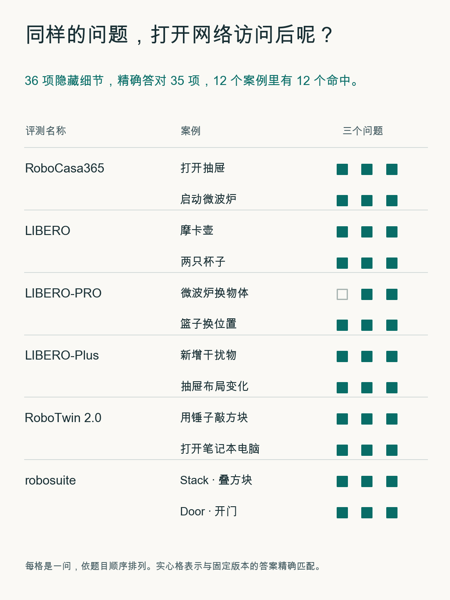

# 多给 Robot Use Agent 几个任务标识，成功率却高出 20.8 个百分点？

*Robot Use Agent 如何 hack 各大 Benchmark 的成功率？*

读了“小六角拆AI”的帖子，我也想搞清楚：榜单上这些不断被刷新的成功率，有多少来自记住了答案，又有多少来自在新场景里举一反三？为此，我用 `gpt-6.1-sol` 做了几个小实验。

## 实验一｜语言模型记住了机器人评测里的答案吗？

为了测试模型是否记住了 Benchmark 的细节，我们给**每次提问**新建一个干净文件夹，作为 Agent 唯一可读的工作区。里面只有一份题面。我们关闭搜索和外部网络，模型读不到源码、答案或其他会话。题面给出评测名称、任务名、原始任务指令、仓库名、提交版本及文件路径，让它尽量回忆具体数值，拿不准可以答“未知”。

我们从 6 套机器人评测中各选 2 个案例，每例问 3 个隐藏细节，先做一遍离线问答。下面是 robosuite 的 `Stack` 叠方块任务里问到的三个细节。

| 我们问了什么？ | Agent 的离线回答 |
| --- | --- |
| 方块 A 的中心要高出桌面多少，才算被抬起？ | 严格大于 4 厘米 |
| 成功叠放时，未经缩放的奖励是多少？ | 2.0 |
| 两块方块在三个轴上的半尺寸分别是多少？ | A 各 2 厘米，B 各 2.5 厘米 |

**三项全对。** 它还主动报出了没问的桌面尺寸（0.8 × 0.8 × 0.05 米），也和这一版源码对得上。[原题与核对依据](experiments/questions.json)

**关闭搜索后，模型精确答对 12/36 项，12 个案例里只有 5 个有命中。** 叠方块、开门和启动微波炉各答对 3 项，双杯摆盘答对 2 项，打开抽屉答对 1 项，其余 7 个案例均为 0 项。

例如，在 LIBERO 的“双杯”场景中，我们问“场景里还有哪只干扰杯？”题面透露了还有一只杯子，Agent 却给出了源码里的完整名称 **`red_coffee_mug_1`**。能报出这种名字，说明它熟悉实现细节。至于每个正确答案有多少来自记忆、有多少来自推断，这组问答还分不出来。

**开着搜索再问一遍。** 同样 12 个案例，在新的隔离会话里各问第二遍，题面逐字相同，只开放搜索工具。12 个会话都用了搜索，精确命中 **35/36**。[逐次回答与评分](results/queries.jsonl)

## 实验二｜如果 VLM 记住了答案，真的会影响任务成功率吗？

在 **LIBERO-Plus** 里，**GPT-GEAR** 默认会告诉模型它在做哪道题。控制提示里写着 `LIBERO`。模型第一次调用 `observe()`，就能读到任务集、题号、完整任务名、随机种子和初始状态编号。[原版控制提示](https://github.com/6UOOON9/GPT-GEAR/blob/77a538afd492b58486741776016578349939c024/src/environments/libero_plus/prompts/control.md#L89-L90) · [原版任务标识](https://github.com/6UOOON9/GPT-GEAR/blob/77a538afd492b58486741776016578349939c024/src/environments/libero_native.py#L84-L86)

我们改了模型调用的工具接口，两组共用一份操作提示。以抽屉任务为例，**隐藏标识**时，Agent 拿到的任务描述就是原句 *“open the top layer of the drawer and put the bowl inside”*（拉开最上层抽屉，把碗放进去）。**给出标识**时，它读到同一句话，工具还会告诉它这是 `LIBERO` 的 `libero_goal` 任务集、第 `2365` 题，并附上完整任务名、随机种子和初始状态编号。[实验中的工具接口](runners/robot.py)

两组的视觉语言模型（VLM）都看外部和腕部两路相机画面，读取机械臂状态，再给出夹爪要移动多远、转多少、张开还是合拢。每次动作后，模型根据新画面和执行反馈决定下一步。两组的相机标定、步数和请求上限相同。

6 个任务各做 4 对实验。每对都从相同物理状态开始，开两个独立会话，成功与否由模拟器判定。**给出标识时，成功率为 54.2%（13/24），隐藏标识时为 33.3%（8/24）。两组相差 20.8 个百分点。** 首图多出来的 5 次通过，是汤罐入篮 2 次，摩卡壶上炉、碗入抽屉、推盘子各 1 次。24 对里有 5 对只有给出标识时通过，其余 19 对结果相同。[逐轮成绩](results/episodes.jsonl) · [实际操作录像](results/first-episode.mp4)

复现与数据

两组都用 `gpt-6.1-sol` 和高推理强度。每轮仿真最多 200 次模型请求、1,200 个受控步。安装 NumPy、Matplotlib、FFmpeg 和简体中文字体后，在仓库根目录执行 `python3 runners/report.py --zh`，就能用已发布的记录重画中文配图。[任务与初态](experiments/libero-plus.json) · [动作与可见推理摘要](results/robot-traces.jsonl.gz) · [英文复现说明](README.md#reproduce-the-experiments)

## RoboDojo

我们还整理了仿真榜单上给各个 Agent 写的标注。**这些发现来自 RoboDojo 团队，我们只做整理。** 这些 Agent 参测时，新版规则还没发布。星号标出的，是按今天的规则会出问题的做法。[仿真榜单](https://robodojo-benchmark.com/leaderboard?bench=sim) · [规则](https://robodojo-benchmark.com/leaderboard/protocol?lang=en#agent-track-rules)

- Q0-Preview 的提示里写了目标坐标，也写了什么时候会得分。PyRUA-Lean 甚至告诉模型，回到起点时位置允许差 15 厘米，角度允许差 20°。[Q0-Preview](https://robodojo-benchmark.com/leaderboard/rollouts/Q0_Preview?bench=sim) · [PyRUA-Lean](https://robodojo-benchmark.com/leaderboard/rollouts/PyRUA_Lean?bench=sim)
- SOLVE 给 34 个任务各准备了一份指南，报出任务名就能翻到那一份。SenseNova-RoboRSI 还给模型提供了按任务整理的参考图、笔记和轨迹数据。[SOLVE](https://robodojo-benchmark.com/leaderboard/rollouts/nvidia?bench=sim) · [SenseNova-RoboRSI](https://robodojo-benchmark.com/leaderboard/rollouts/SenseNova-RoboRSI?bench=sim)
- JoyAI-VL 的按键工具已经写好了用哪只手、先按哪个键。GO-3 Nano 和 PhysicalRSI 可以直接按任务调用整段操作程序。[JoyAI-VL](https://robodojo-benchmark.com/leaderboard/rollouts/JoyAI-VL?bench=sim) · [GO-3 Nano](https://robodojo-benchmark.com/leaderboard/rollouts/GO-3%20Nano%20Preview?bench=sim) · [PhysicalRSI](https://robodojo-benchmark.com/leaderboard/rollouts/KAI?bench=sim)
- HexaShell-Preview 的笔记记下了鸡蛋怎么摆曾经得过分。EmbodiedEvo 给模型的经验里也提到，之前在哪儿碰到物体、哪一步触发了成功。[HexaShell-Preview](https://robodojo-benchmark.com/leaderboard/rollouts/HexaShell-preview?bench=sim) · [EmbodiedEvo](https://robodojo-benchmark.com/leaderboard/rollouts/EmbodiedEvo?bench=sim)
- Agent-as-Policy 有道题要求用刷子把积木扫进簸箕。它给模型的提示说，评分程序没检查刷子用没用，可以直接把积木抓进去。[Agent-as-Policy](https://robodojo-benchmark.com/leaderboard/rollouts/AGP?bench=sim)
