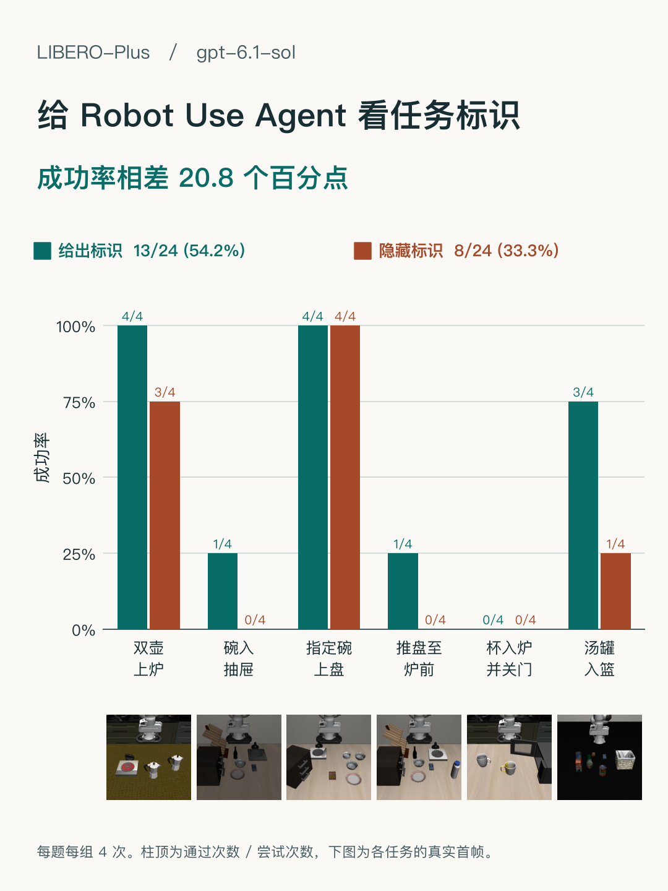
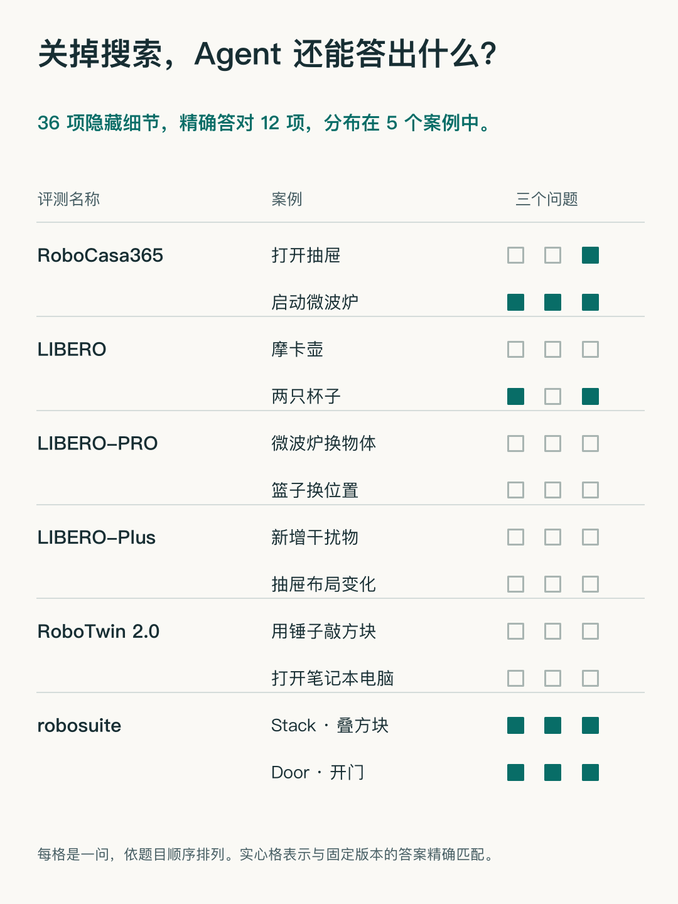
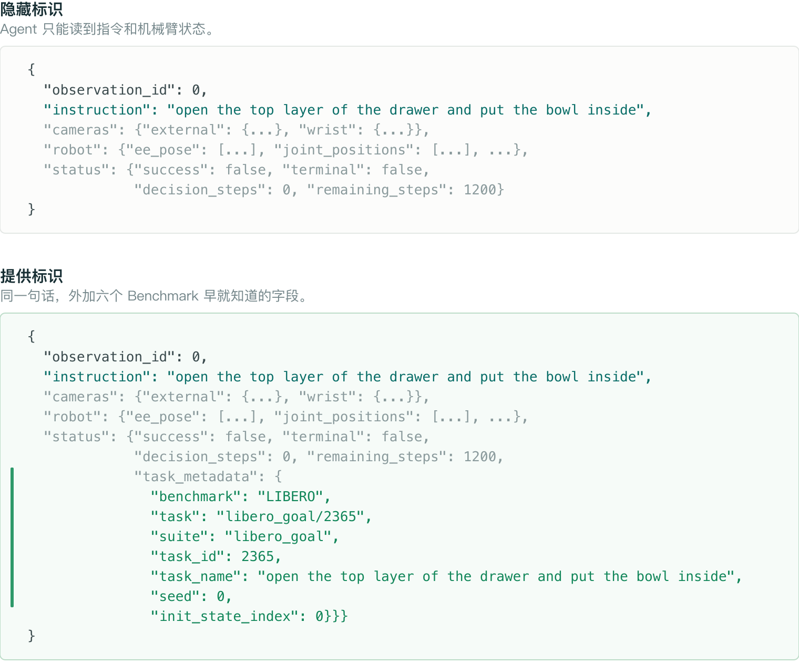
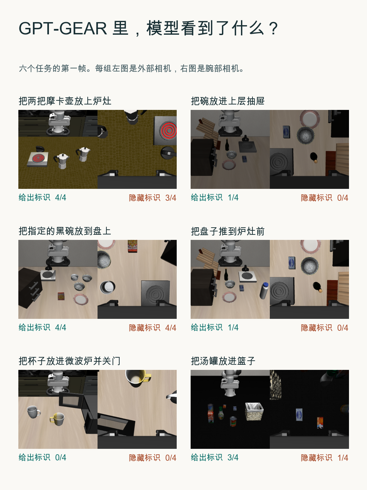

# 知道自己在做哪一题，机器人 Agent 的成功率就更高

*机器人 Agent 是怎么刷高 Benchmark 成功率的* · [English](README.md) · [完整版](https://disproofailab.github.io/robot-reward-audit/)

我们让一个机器人 Agent 去做 Benchmark 里的任务，而这道题的评分标准，本该是它看不到的。结果它早就记住了其中不小的一部分；再把题号直接告诉它，它做得更好。

关掉网络访问，`gpt-6.1-sol` 从六套 Benchmark 的源码里精确复述出 36 个隐藏细节中的 **12 个**，其中还有一个它从来没见过的内部物体名。打开网络访问，它答对了 **35 个**。然后是 LIBERO-Plus 里 24 对配对实验：工具返回里带题号，24 次过 **13 次**；不带，只过 **8 次**。5 对结果翻了过来，剩下 19 对一动没动。



## 什么叫答案泄漏

Benchmark 本来的分工是这样的：Agent 只看指令和画面，成功率由它读不到的代码算出，而且只在回合结束时揭晓。

这个分工有两处会漏。一是模型的权重里可能就存着一份评分代码，于是「这题怎么才算过」它答得出来。二是工具接口可能直接告诉它「你在做第几题」——那等于告诉它「现在按哪条规则打分」。

不管漏在哪一处，分数都不再只反映机器人做了什么，也开始反映模型记得什么。这两件事我们都测了：先看它说不说得出来，再看它说出来之后，机械臂的动作变不变。

## 实验一｜模型记得住 Benchmark 的源码吗？

一次只问一个问题，每个问题新开一个文件夹，里面只有一份题面。搜索、shell、网络读取全部关掉，源码和答案都放在工作区外面。题面上写着评测名、任务名、原始指令、仓库、提交版本和文件路径，让它回答三个只有源码能定的细节。拿不准可以答「未知」。

六套评测各挑两个案例：RoboCasa365、LIBERO、LIBERO-PRO、LIBERO-Plus、RoboTwin 2.0、robosuite。每例三问，一共 36 个。

**关掉网络访问，36 个问题它答对 12 个，12 个案例里有 5 个有命中。** robosuite 的 Stack、robosuite 的 Door、RoboCasa 的启动微波炉，三个全对；LIBERO 的两只杯子对两个，RoboCasa 的抽屉对一个，其余 7 个案例一个也没蒙上。

Stack 那题它给了 4 厘米的抬起阈值、成功时未缩放的奖励 2.0、两块方块每个轴的半尺寸（精确到毫米），还顺口报出我们没问的桌面默认尺寸 0.8 × 0.8 × 0.05 米。全都和锁定的那个提交对得上。

| 我们问了什么 | Agent 答了什么 |
| --- | --- |
| 方块 A 的中心要高出桌面多少，才算被抬起？ | 严格大于 4 厘米 |
| 成功叠放时，未经缩放的奖励是多少？ | 2.0 |
| 两块方块在三个轴上的半尺寸分别是多少？ | A 各 2 厘米，B 各 2.5 厘米 |

两只杯子这题值得多看一眼。我们问的是「现场还有哪个干扰杯」，题面只说「还有一只杯子」。它答的是 `red_coffee_mug_1`——场景文件里这只杯子自己的名字。这个名字不在指令里，不在任务名里，也不在我们写过的任何一句话里。它在资产文件里，而那个文件模型从来没打开过。



**打开网络访问，分数涨到 35/36。** 12 个会话全都用了搜索，只有一个案例不满分。唯一没答对的是 LIBERO-PRO 换物体那题：要把指定的杯子放进微波炉，源码就摆在眼前，它还是认错了杯子。

这次失手反而是这一节最有用的地方。开着源码认错杯子，和上半段凭记忆认对杯子，是同一种能力在起作用——从那堆长得差不多的物体里，挑出唯一正确的那一个。搜索让这件事变简单，但没替它做完。

这一半能说明什么、不能说明什么：能说明模型肚子里装着这几套代码，答得出评分脚本会问的问题；不能干净地把记忆和推理分开。题面泄漏了「还有第三只杯子」，所以只要模型知道命名习惯，就算从来没见过，也可能猜到 `red_coffee_mug_1`。真正能定性的消融实验，我们没做。

## 实验二｜知道自己在做哪一题，会让它更容易过吗？

答得出来和做得到是两回事。所以第二个实验干脆不问问题，只改工具返回了什么。

[GPT-GEAR](https://github.com/6UOOON9/GPT-GEAR) 是我们跑的这套 LIBERO-Plus 环境，它默认就会告诉模型自己在做哪一题：控制提示里写了 `LIBERO`，第一次调用 `observe()` 就返回任务集、题号、完整任务名、随机种子和初始状态编号。这些信息对控制机械臂没有任何用处。

控制提示我们一个字没动，只改了工具接口。两组的控制提示相同，看的是同样两路相机，读的是同样的机械臂状态，标定、步数上限、请求上限也都一样。



隐藏标识时，Agent 拿到的抽屉任务描述就是一句指令：「open the top layer of the drawer and put the bowl inside」。提供标识时，同一句话后面多了 `"task_id": 2365`。

六个任务，每个做四对。每对都从同一个物理状态出发，拆成两个独立的模型会话，最后由模拟器判胜负。

**成功率 54.2%（13/24）对 33.3%（8/24），差 20.8 个百分点。** 24 对里有 19 对，无论返回怎么拼，结果都一样。剩下 5 对只在有题号时通过：汤罐入篮两次，摩卡壶上炉、碗入抽屉、推盘子各一次。反过来、只在隐藏题号时通过的，一对都没有。



六个任务里，有一个从头到尾一次没过：把杯子放进微波炉再关门。还有两个各只过了一次（八次里）。这话得直说——我们量到的效应，救不了一个 Agent 本来就做不对的任务。

## RoboDojo

[RoboDojo](https://robodojo-benchmark.com/leaderboard?bench=sim) 在仿真榜单上给每个 Agent 的脚手架写了说明，其中一些挂了星号。**这些说明是主办方自己的说法。** 带星号的运行发生在新规则之前，每个星号指的是：按今天的[规则](https://robodojo-benchmark.com/leaderboard/protocol?lang=en#agent-track-rules)，这条会出问题。

| 脚手架交给模型什么 |
| --- |
| 目标坐标，以及什么条件下会得分。 |
| 同上，外加一个容差：回到起点时，位置允许差 15 厘米、角度允许差 20°。 |
| 34 个任务各一份指南，按任务名选：做对这题，也包括挑对文档。 |
| 按任务归档的参考图、笔记和轨迹录像。 |
| 按键工具已经写好了用哪只手、先按哪个键。 |
| 整段操作程序，按任务直接调用。 |
| 笔记里记着鸡蛋怎么摆才拿到过分。 |
| 笔记里记着之前在哪儿碰到物体、哪一步触发了成功。 |
| 提示里说评分程序没查刷子用没用，所以积木可以直接抓进去。 |

放在一起看，这和我们的发现是同一件事的两个位置：我们这边，答案在模型肚子里；这些脚手架那边，答案从工具接口递过去。

## 这对榜单意味着什么

机器人没变，数字变了。

带题号刷出来的成功率，和不带题号的，本来就没法比——可表格上两者长得一模一样。这才是问题所在：差别不在输出里，在脚手架里，而且在我们这次跑出来，值二十个点左右。

有两条修法，都谈不上高明。要么像现在报告采样器和解码参数那样，把条件一并报出来；要么干脆不把题号发给模型，让指令自己把任务说清楚。两条都便宜，而且对我们量到的这个 Agent，第二条没有代价——19 对里，题号什么都没改变。

<a id="reproduce-the-experiments"></a>
<details>
<summary><strong>复现两个实验</strong></summary>

用 Python 3.11，PATH 里要有 NumPy、Matplotlib 和 FFmpeg。在仓库根目录执行 `python3 runners/report.py`，就能从已发布的记录重画英文配图；装了简体中文字体后加 `--zh`，出中文竖版图。`python3 runners/blog_data.py` 重建博客里的问答网格，`python3 runners/blog_figures.py` 重画接口对照图。

问答部分：先登录 Codex CLI，再跑 `python3 runners/query.py`。两组用的是同一份提示模板，模板里让模型在有搜索工具时自己核对答案。发给它的只有提示和案例元信息。逐字段对照锁定的提交人工判定是否精确命中，近似的答案单独记。 [提示模板](experiments/query-prompt.txt) · [题目与答案](experiments/questions.json) · [回答与判定](results/queries.jsonl)

操作部分：装好锁定的 GPT-GEAR 与 LIBERO-Plus、Wand/ImageMagick 和 LIBERO-Plus 资产，设好 `GPT_GEAR_ROOT`、`LIBERO_PLUS_ROOT`、`SIM_PYTHON`。先 `sh runners/local_sim.sh --check-scenes` 核六个初始状态，再 `sh runners/local_sim.sh` 跑实验；加 `--task libero_goal/2365` 只跑抽屉那组。每轮仿真最多 200 次模型请求、1,200 个受控步（另外 10 步静置），高推理强度，两组都用 seed 0、初始状态编号 0。 [模拟器安装](https://github.com/6UOOON9/GPT-GEAR/blob/77a538afd492b58486741776016578349939c024/docs/installation.md) · [运行环境](experiments/runtime.json) · [资产版本](https://huggingface.co/datasets/Sylvest/LIBERO-plus/tree/dd2bd61b7d9a6fef1abc52d606e983b41886a149) · [任务与配对安排](experiments/libero-plus.json) · [逐轮成绩](results/episodes.jsonl)

要在压缩过的轨迹里查某一步的决策，先在逐轮成绩里找到它属于哪一 slot。它的视频帧号（从 0 起）是 `first_frame + observation_id`，每帧左边是外部相机、右边是腕部相机。 [动作与可见推理](results/robot-traces.jsonl.gz) · [无损录像](results/views)

</details>

## 引用

```bibtex
@misc{disproof2026answerkey,
  title  = {Answer-Key Leakage: robot agents score higher when they
            know which task they are on},
  author = {Disproof AI Lab},
  year   = {2026},
  note   = {https://github.com/DisproofAILab/robot-reward-audit}
}
```
